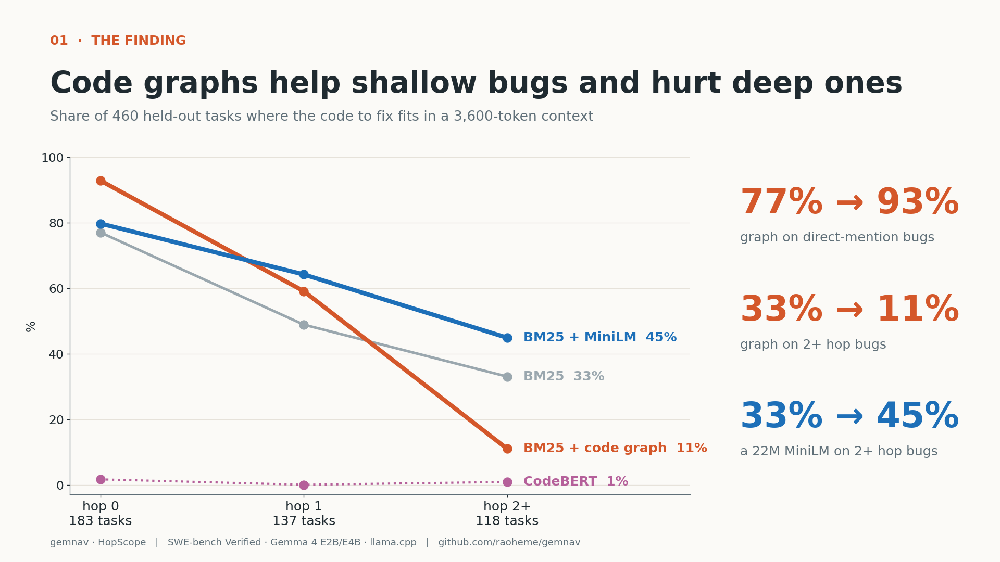

# gemnav · HopScope

**Where code graphs help small coding agents, and where they hurt.** Every SWE-bench Verified task is labelled with its
dependency depth: graph hops from what the issue names to the code that must change. Retrieval is then measured by depth
under a small-model context budget, and an offline guarded repair agent runs Gemma 4 E2B/E4B on llama.cpp.
Kaggle *Gemma 4 Developer Agent Paper* submission; the paper is [`PAPER.md`](PAPER.md), future work is
[`ROADMAP_AND_FUTURE_WORK.md`](ROADMAP_AND_FUTURE_WORK.md).



| Gold inside a 3,600-token context (460 held-out tasks) | Hop 0 | Hop 1 | Hop 2+ | All |
|---|---|---|---|---|
| BM25 | 77.0 | 48.9 | 33.1 | 56.7 |
| BM25 + code graph (RRF) | **92.9** | 59.1 | 11.0 | 60.4 |
| BM25 + MiniLM (RRF) | 79.8 | **64.2** | **44.9** | **65.7** |
| CodeBERT (mean-pooled) | 1.6 | 0.0 | 0.8 | 0.9 |

Gemma 4 E4B end-to-end on 50 held-out tasks (official harness): 8 patches, 7 in the right file, 1 at 167/168 target tests,
**0 resolved**. The bottleneck is exact edits, not retrieval. Laptop (Ryzen 5 5500U, 8 GB): E2B on CPU at
114 prompt / 5.4 gen tok/s; the iGPU cannot run it.

## Layout
```
code/swe_local/    code graph (ast), BM25/graph retrievers, routers (logistic, MLP, predictive coding), guards, git transactions
code/gemnav/       agent: tree-sitter chunker, embedders (MiniLM/CodeBERT/GraphCodeBERT/Jina), SQLite vector store,
                   pylsp client, per-tool GBNF grammar, llama.cpp client, guarded repair loop, Docker / rootfs task envs
code/experiments/  E1 graph localisation, E2/E3 guards + rollback, E5 dense retrieval, end-to-end runners, analysis, figures
code/kaggle/       self-contained Kaggle T4x2 kernel builder + drivers (E5 embeddings, E4B end-to-end)
code/laptop/       Windows + Docker Desktop runner: speed gate, indexing bench, E2B e2e, official scoring
code/tests/        20 tests:  python -m pytest code/tests
results/           per-task JSONL for every experiment, summaries, harness reports, Kaggle logs, figures, gallery
notebooklm/        sources + prompts used to make the video, slides and infographics
```

## Reproduce
```bash
pip install numpy pyarrow matplotlib pytest psutil tree-sitter==0.26.1 tree-sitter-python==0.25.0 onnxruntime \
            tokenizers huggingface_hub python-lsp-server jedi
python -m pytest code/tests
python code/experiments/exp_localization.py --parquet verified.parquet --repo django/django --out results/e1_django.jsonl
python code/experiments/analyze_localization.py results/e1_localization_tasks.jsonl results/e1_summary.json
python code/experiments/analyze_dense.py results/kaggle_e5 results/e1_localization_tasks.jsonl results/e5_summary.json
python code/experiments/make_gallery.py results results/gallery
# agent against a local model
llama-server -m gemma-4-E4B_q4_0-it.gguf -c 8192 -fa on --jinja --swa-full --cache-type-k q4_0 --cache-type-v q4_0
```
Dataset `princeton-nlp/SWE-bench_Verified`. Models `google/gemma-4-E2B-it-qat-q4_0-gguf` (rev 675cff4) and
`google/gemma-4-E4B-it-qat-q4_0-gguf` (rev 4b4a2c1), SHA-256 verified by the runners. llama.cpp b12211.

License: Apache-2.0.
